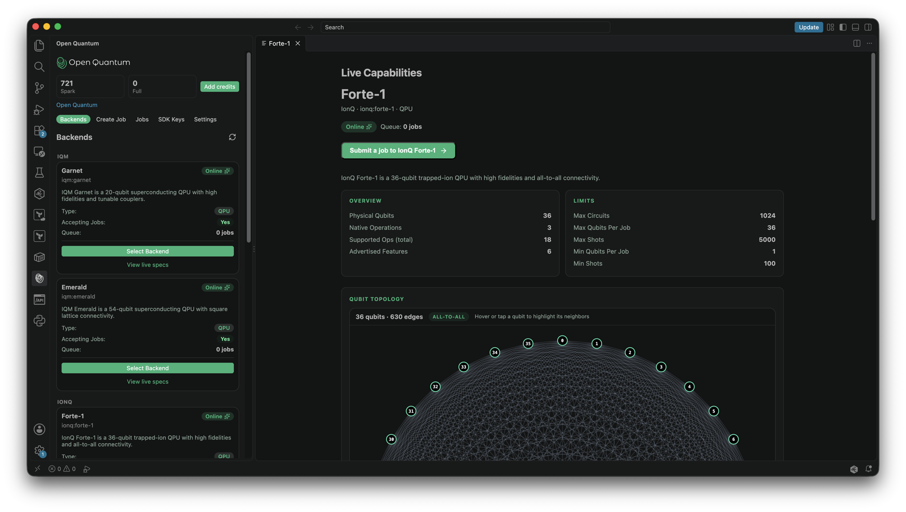
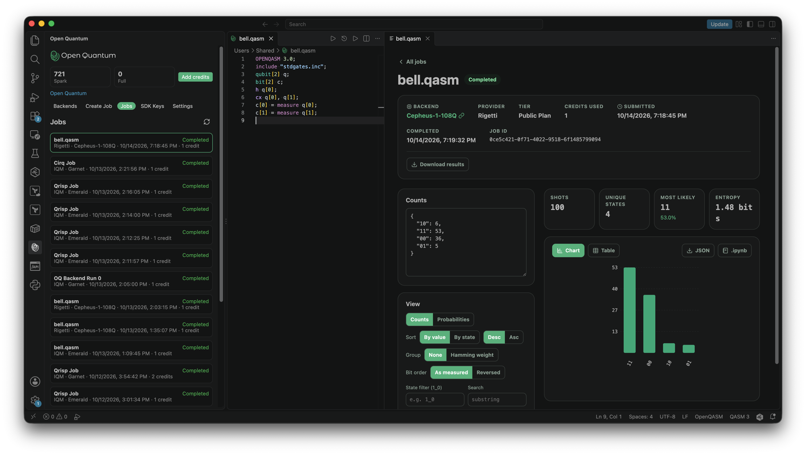

# Open Quantum

Copyright 2026 Open Quantum / Quantum Rings

[Open Quantum](https://www.openquantum.com) · [Quantum Rings](https://www.quantumrings.com)

## Features

- Syntax highlighting and error parsing for OpenQASM 2 and OpenQASM 3 (`.qasm`, `.qasm2`, `.qasm3`, `.openqasm`)
- Optionally run on real Quantum Computers and Simulators with [Open Quantum](https://www.openquantum.com)





## Example

```qasm
OPENQASM 3.0;
include "stdgates.inc";
qubit[2] q;
bit[2] c;
h q[0];
cx q[0], q[1];
c[0] = measure q[0];
c[1] = measure q[1];
```

## Validate a circuit

1. In the Extensions view, install **Open Quantum**.
2. Create a key at [openquantum.com/settings/keys](https://www.openquantum.com/settings/keys). In the Open Quantum pane, open **SDK keys** and choose **Set SDK key**.
3. **Backends** lists backends for the selected organization, with status and queue. **Details** opens the coupling map and gates. **Use** opens Create job with that backend.
4. Open a `.qasm` file. **Run Without Debugging** opens Create job. Pick a backend, a category, and a subcategory. Set the configuration, then **Validate**. That checks the circuit and configuration and returns a quote.
5. Pick a plan and a queue, then **Submit**. The pane opens **Jobs** and selects the new job. The job window matches the website: status, backend, provider, tier, credits, and a results explorer with a counts chart or table, filters, bit order, and JSON or notebook downloads. **Load more…** fetches the next page. The list refreshes every 30 seconds.
6. **Add credits** opens [openquantum.com/buy-credits](https://www.openquantum.com/buy-credits). **Settings** switches organization. The header shows Spark and Full credits.
